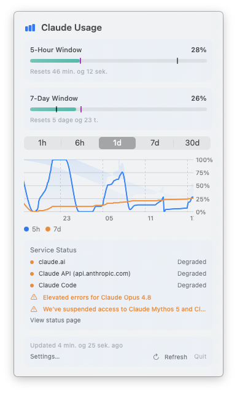

<p align="center">
  
</p>

# Claude Usage Bar

Have you ever found yourself refreshing the Claude usage page, wondering how close you are to hitting your rate limit? Yeah, I've been there too. So I built this.

Now it's just a glimpse away — always sitting at the top of your screen.

<p align="center">
  
</p>


## What it does

A small macOS menu bar app that shows how much of your Claude plan's usage limits you've used.

- A menu bar icon with two mini bars for your 5-hour and 7-day limits
- A popover with each limit's usage and reset time, a per-model breakdown when your plan has one, and extra usage in USD
- A usage history chart from the last hour to the last 30 days; hover it for exact values
- Notifications when a limit passes a percentage you choose
- Launch at login, and a choice of how often to refresh (every 5 minutes to every hour)
- Sign in with your Claude account in the browser; no API key needed
- Updates itself

## Install

1. Download `ClaudeUsageBar.dmg` from the [latest release](https://github.com/Blimp-Labs/claude-usage-bar/releases/latest).
2. Open it and drag **ClaudeUsageBar** into **Applications**.
3. Open the app from **Applications**. It runs from the disk image too, but can't update itself there.

The app isn't notarized by Apple, so macOS blocks the first launch:

- **macOS 15 and later:** after the warning, open **System Settings → Privacy & Security**, scroll to **Security**, click **Open Anyway**, and confirm with your password. The button appears for about an hour after the blocked launch.
- **macOS 14:** Control-click the app in Applications, choose **Open**, then **Open** again.

You only do this once. Updates install without the warning.

## Usage

1. Click the menu bar icon, then **Sign in with Claude**.
2. Approve access in your browser, copy the code it shows, and paste it into the app.
3. The icon now shows your usage and refreshes every 30 minutes by default.

Click the icon any time for the details. **Settings…** in the popover has:

- **General:** launch at login, and how often to refresh
- **Notifications:** an alert threshold for the 5-hour, 7-day and extra-usage limits, or **Off**
- **Account:** the signed-in account, and **Sign Out**
- **Updates:** your version, the daily update check, and **Check for Updates…**

## Updates

The app checks for a new version once a day and asks before installing it. Turn the daily check off, or check right away, in **Settings → Updates**.

## Privacy & data

Your data stays on your Mac, in `~/.config/claude-usage-bar/`:

| File | Contents |
|------|----------|
| `credentials.json` | Your sign-in tokens, readable only by you |
| `history.json` | Usage history for the chart, kept for 30 days, readable only by you |

If Claude Code is installed, the app also reads your account email from `~/.claude.json` to show which account is signed in.

The app only connects to:

- `claude.ai` and `platform.claude.com`, to sign you in
- `api.anthropic.com`, to read your usage and account email
- `blimp-labs.github.io`, to check for updates, and GitHub's release downloads, to fetch them

**Settings → Account → Sign Out** deletes your saved tokens.

## Uninstall

1. Turn off **Launch at login** in Settings, then click **Quit** in the popover.
2. Delete **ClaudeUsageBar** from Applications.
3. To remove your data and settings too:

   ```sh
   rm -rf ~/.config/claude-usage-bar
   defaults delete com.local.ClaudeUsageBar
   ```

## Build from source

Clone the repo and run `make install` to build the app and copy it to Applications. Builds made this way don't update themselves; see [CONTRIBUTING.md](CONTRIBUTING.md) for requirements and details.

## Contributing

See [CONTRIBUTING.md](CONTRIBUTING.md) for development setup, testing, and how to submit changes.

## License

[BSD 2-Clause](LICENSE)
